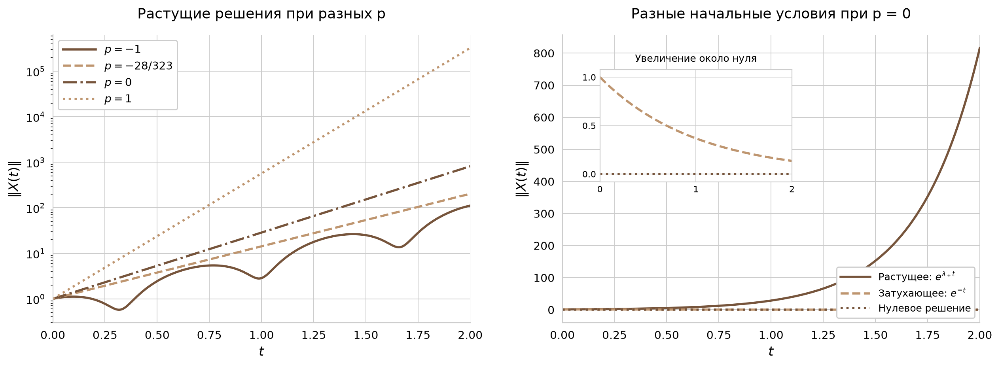

# Устойчивость линейной системы
**Задание 3.1.** Рассмотрите систему трёх дифференциальных уравнений $\frac{d\mathbf X}{dt}=A\mathbf X$, где
$$
A=
\begin{pmatrix}
-3 & k & 0\\
m & -2 & p\\
m+k & 0 & -1
\end{pmatrix}.
$$

При каких значениях вещественного параметра $p$ положение равновесия этой системы:
а) устойчиво;
б) асимптотически устойчиво;
в) неустойчиво?

В случае, когда система относится к типу а), но не относится к типу б), опишите поведение решения при $t\to+\infty$: какие тут возможны варианты? Желательно построить графики, иллюстрирующие эти варианты.

Рассмотрим $X'=AX$, где
$$A=\begin{pmatrix}-3&k&0\\m&-2&p\\m+k&0&-1\end{pmatrix},\qquad p\in\mathbb R.$$
Найти значения $p$, при которых равновесие устойчиво, асимптотически устойчиво или неустойчиво. Для устойчивого, но не асимптотически устойчивого случая описать поведение решений.

## Решение
Собственные числа определяют устойчивость следующим образом:
решение линейной системы строится из функций $e^{\lambda t}v$ и, при жордановых клетках, из $t^j e^{\lambda t}v$. Если все $\mathrm{Re}\,\lambda<0$, равновесие асимптотически устойчиво; если все $\mathrm{Re}\,\lambda\le0$ и на мнимой оси нет нетривиальных жордановых клеток, равновесие устойчиво; если хотя бы одно $\mathrm{Re}\,\lambda>0$, равновесие неустойчиво.

Достаточно доказать, что в нашей задаче при любом $p$ существует собственное число с положительной вещественной частью.

##### Найдём определитель матрицы

Раскладываем определитель по первой строке: 
$$(\lambda+3)(\lambda+2)(\lambda+1)-km(\lambda+1)-kp(m+k)=0.$$ Сначала перемножим первые две скобки:
$$(\lambda+3)(\lambda+2)=\lambda^2+2\lambda+3\lambda+6=\lambda^2+5\lambda+6.$$ Умножим результат на третью скобку: $$(\lambda^2+5\lambda+6)(\lambda+1)=\lambda^3+\lambda^2+5\lambda^2+5\lambda+6\lambda+6.$$ Приведём подобные слагаемые: $$(\lambda+3)(\lambda+2)(\lambda+1)=\lambda^3+6\lambda^2+11\lambda+6.$$

Раскроем оставшиеся скобки:
$$
-km(\lambda+1)=-km\lambda-km,
$$
$$
-kp(m+k)=-kmp-k^2p.
$$

Подставим всё в уравнение:
$$
\lambda^3+6\lambda^2+11\lambda+6
-km\lambda-km-kmp-k^2p=0.
$$

Соберём слагаемые при \(\lambda\):
$$
\lambda^3+6\lambda^2+(11-km)\lambda
+6-km-kmp-k^2p=0.
$$

Теперь подставим постоянные:
$$
\lambda^3+6\lambda^2+(11-17\cdot2)\lambda
+6-17\cdot2-17\cdot2p-17^2p=0.
$$

Получаем уравнение:
$$
\lambda^3+6\lambda^2-23\lambda-28-323p=0.
$$

##### Доказываем неустойчивость при любом $p$
Получили характеристическое уравнение:
$$
\lambda^3+6\lambda^2-23\lambda-28-323p=0.
$$

Для устойчивости необходимо, чтобы вещественные части всех собственных чисел были неположительными.

По формулам Виета:
$$
\lambda_1\lambda_2+\lambda_1\lambda_3+\lambda_2\lambda_3=-23.
$$

Все корни вещественные. Если они неположительные, то каждое попарное произведение неотрицательно. Их сумма не может равняться -23.

Есть комплексно-сопряжённая пара. При неположительных вещественных частях запишем:
$$
\lambda_1=-a,\qquad
\lambda_2=-b+ic,\qquad
\lambda_3=-b-ic,\qquad a,b\ge0.
$$

Тогда:
$$
\lambda_1\lambda_2+\lambda_1\lambda_3+\lambda_2\lambda_3
=2ab+b^2+c^2\ge0.
$$

Снова получаем противоречие с -23.

Следовательно, при любом $p$ существует собственное число с положительной вещественной частью. Поэтому равновесие неустойчиво.

##### Построение графиков

Для примера возьмём $p=0$. Тогда характеристическое уравнение:
$$
(\lambda+1)(\lambda^2+5\lambda-28)=0.
$$

Собственные числа:
$$
\lambda_1=-1,\qquad
\lambda_2\approx3.35235,\qquad
\lambda_3\approx-8.35235.
$$

Выберем начальные условия вдоль соответствующих собственных векторов единичной длины. Тогда нормы решений равны:
$$
\|X_1(t)\|=e^{-t},\qquad
\|X_2(t)\|=e^{3.35235t},\qquad
\|X_3(t)\|=e^{-8.35235t}.
$$

Построим их на отрезке $0\le t\le2$. На нём уже хорошо видны рост и затухание решений.

Первое и третье решения стремятся к нулю, второе неограниченно растёт. Наличие растущего решения показывает неустойчивость равновесия: даже сколь угодно малое начальное отклонение в этом направлении со временем увеличивается.

##### Комментарий к графикам

На левом графике показаны растущие решения при четырёх выбранных значениях $p$. Их нормы со временем неограниченно увеличиваются. При $p=-1$ рост сопровождается колебаниями, поскольку соответствующие собственные числа комплексные и имеют положительную вещественную часть.

Следствие: при каждом из выбранных $p$ равновесие неустойчиво. График иллюстрирует результат; неустойчивость при всех остальных вещественных $p$ следует из доказательства выше.

На правом графике при $p=0$ показаны три варианта поведения: растущее решение удаляется от равновесия, затухающее решение приближается к равновесию и нулевое решение остаётся в равновесии.

Следствие: равновесие неустойчиво. Наличие других, затухающих решений этого не меняет: для устойчивости необходимо, чтобы все достаточно малые начальные отклонения оставались малыми.

Таким образом, отвечая на вопросы:

А) Тип равновесия: устойчивый; значение параметра $p$: таких значений нет

Б) Тип равновесия: асимптотически устойчивый; значение параметра $p$: таких значений нет

В) Тип равновесия: неустойчивый; значения параметра $p\in\mathbb R$
