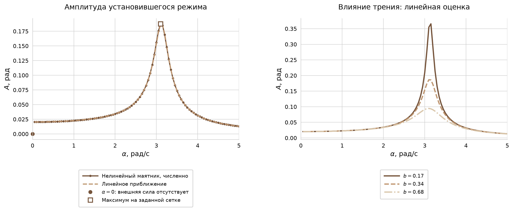
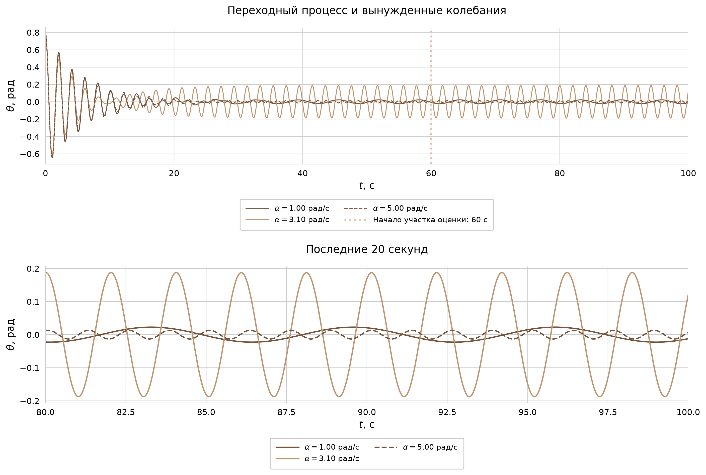

## Маятник с трением и периодической внешней силой
**Задание 3.3.** Анализ математического маятника с трением и внешней силой

Рассмотрим физический маятник, состоящий из жёсткого стержня длиной $l$ и груза массой $m_0$ на его конце, на который действует ускорение свободного падения $g$. Маятник затухает из-за наличия силы трения, пропорциональной его угловой скорости, которую характеризует коэффициент затухания $b$. Кроме того, на маятник действует внешняя периодическая сила с синусоидальной формой $F\sin(\alpha t)$, где $F$ — амплитуда силы, а $\alpha$ — угловая частота внешней силы.

Уравнение движения маятника задаётся нелинейным дифференциальным уравнением второго порядка:

$$
\frac{d^2\theta}{dt^2}
+\frac{b}{m_0}\frac{d\theta}{dt}
+\frac{g}{l}\sin(\theta)
=F\sin(\alpha t),
$$

где $\theta$ представляет собой угловое смещение от вертикали.

**Параметры задачи.**

- Длина маятника $l$: 1 м.
- Масса груза $m_0$: 1 кг.
- Ускорение свободного падения $g$: 9.81 м/с².
- Коэффициент затухания $b$: k/50 кг·м²/с, $k$ — номер студента в списке.
- Амплитуда силы $F$: m/10 $Н$, $m$ — номер группы.
- Начальное угловое смещение $\theta_0$: $\pi/4$ рад.
- Начальная угловая скорость $\omega_0$: 0 рад/с.
- Время интегрирования: $0\le t\le100$ с.

**Задания.**

1. **Приведение к системе уравнений первого порядка.** Преобразуйте данное дифференциальное уравнение второго порядка в эквивалентную систему двух дифференциальных уравнений первого порядка (ОДУ). Введите соответствующие подстановочные переменные для представления углового смещения $\theta$ и угловой скорости $\omega$.

2. **Определение параметров.** Определите все параметры, используемые в системе, включая физические константы, начальные условия и диапазон угловой частоты внешней силы $\alpha$.

3. **Численное решение.** Используя MATLAB, численно решите систему уравнений первого порядка для ряда значений $\alpha$, чтобы исследовать выход на периодический режим маятника. Ваша симуляция должна охватывать диапазон значений $\alpha$ от 0 до 5 рад/с с интервалами в 0.05 рад/с.

4. **Графическое представление.** Постройте график амплитуды колебаний маятника в зависимости от частоты $\alpha$. Амплитуда должна быть определена после выхода на режим с достаточной точностью (нужно объяснить, как это время определяется).

5. **Анализ.** Проведите анализ полученного графика, обсудите физическую интерпретацию поведения маятника в ответ на изменение частоты привода $\alpha$. В частности, определите явления резонанса и объясните влияние демпфирования на амплитуду колебаний маятника.

**Результат задания.**

- Скрипт MATLAB, который выполняет численное решение и генерирует требуемый график.
- Краткий отчёт, включающий в себя полученную систему дифференциальных уравнений первого порядка, код MATLAB, сгенерированный график и ваш анализ поведения амплитуды маятника как функции от $\alpha$.

## Решение

Решить $$\theta''+\frac b{m_0}\theta'+\frac gl\sin\theta=F\sin(\alpha t),$$

при $l=1$, $m_0=1$, $g=9.81$, $b=k/50$, $F=m/10$, $\theta(0)=\pi/4$, $\theta'(0)=0$, $0\le t\le100$.

Частоты: $\alpha=0,0.05,\ldots,5$. Построить амплитудно-частотную характеристику после затухания переходного процесса, объяснить резонанс и влияние трения.

**Переходём к системе первого порядка**. Вводим угловую скорость $\omega=\theta'$. Тогда
$$\begin{cases}\theta'=\omega,\\\omega'=-\dfrac b{m_0}\omega-\dfrac gl\sin\theta+F\sin(\alpha t).\end{cases}$$

Начальные условия:
$$\theta(0)=\frac\pi4\approx0.7853981634,\qquad\omega(0)=0.$$

Используется именно уравнение, напечатанное в условии. Масса $m_0$ и номер группы $m$ — разные обозначения.

**Подставляем параметры**. $$b=\frac{17}{50}=0.34,\qquad F=\frac2{10}=0.2,$$
$$\theta'=\omega,\qquad\omega'=-0.34\omega-9.81\sin\theta+0.2\sin(\alpha t).$$

Частоты изменяем от 0 до 5 с шагом 0.05. Число расчётов:
$$N_\alpha=\frac{5-0}{0.05}+1=101.$$

**Находим линейную оценку амплитуды**. В установившемся режиме углы окажутся небольшими. При малых углах $\sin\theta\approx\theta$: $\theta''+0.34\theta'+9.81\theta=0.2\sin(\alpha t)$.

Ищем установившееся решение:
$$
\theta_s=u\sin(\alpha t)+v\cos(\alpha t).
$$

Его производные:
$$
\theta_s'=\alpha u\cos(\alpha t)-\alpha v\sin(\alpha t),
$$
$$
\theta_s''=-\alpha^2u\sin(\alpha t)-\alpha^2v\cos(\alpha t).
$$

Подставляем в уравнение и собираем слагаемые:
$$
\left((9.81-\alpha^2)u-0.34\alpha v\right)\sin(\alpha t)
+
\left(0.34\alpha u+(9.81-\alpha^2)v\right)\cos(\alpha t)
=
0.2\sin(\alpha t).
$$

Следовательно:
$$
\begin{cases}
(9.81-\alpha^2)u-0.34\alpha v=0.2,\\
0.34\alpha u+(9.81-\alpha^2)v=0.
\end{cases}
$$

Обозначим:
$$
\Delta=9.81-\alpha^2,\qquad c=0.34\alpha,
\qquad D=\Delta^2+c^2.
$$

Умножая первое уравнение на $\Delta$, второе — на $c$, и складывая, получаем:
$$
\Delta^2u-\Delta cv+c^2u+c\Delta v=0.2\Delta,
$$

$$
Du=0.2\Delta,
\qquad
u=\frac{0.2\Delta}{D}.
$$

Аналогично, умножая первое уравнение на $-c$, второе — на $\Delta$, получаем:
$$
Dv=-0.2c,
\qquad
v=-\frac{0.2c}{D}.
$$

Амплитуда:
$$
A_{\mathrm{lin}}=\sqrt{u^2+v^2}
=\sqrt{\frac{0.2^2\Delta^2+0.2^2c^2}{D^2}}
=\sqrt{\frac{0.2^2D}{D^2}}
=\frac{0.2}{\sqrt D}.
$$

Таким образом, при $\alpha>0$:
$$
A_{\mathrm{lin}}(\alpha)
=\frac{0.2}{\sqrt{(9.81-\alpha^2)^2+0.34^2\alpha^2}}.
$$

**Находим резонансную частоту линейной модели**. Максимум амплитуды соответствует минимуму:
$$
D(\alpha)=(9.81-\alpha^2)^2+0.1156\alpha^2.
$$

Дифференцируем:
$$
D'(\alpha)
=2(9.81-\alpha^2)(-2\alpha)+0.2312\alpha,
$$
$$
D'(\alpha)=2\alpha\bigl(-2(9.81-\alpha^2)+0.1156\bigr).
$$

При \(\alpha>0\) условие \(D'(\alpha)=0\) даёт:
$$
-19.62+2\alpha^2+0.1156=0,
$$
$$
2\alpha^2=19.5044,
\qquad
\alpha^2=9.7522.
$$

Следовательно:
$$
\alpha_{\mathrm{рез,lin}}=\sqrt{9.7522}
\approx3.12285\ \mathrm{рад/с}.
$$

Здесь $D'$ меняет знак с минуса на плюс, поэтому найден минимум знаменателя.

Подставляем частоту в формулу амплитуды:
$$
A_{\max,\mathrm{lin}}
=
\frac{0.2}
{\sqrt{(9.81-9.7522)^2+0.1156\cdot9.7522}},
$$
$$
A_{\max,\mathrm{lin}}
=
\frac{0.2}{\sqrt{0.0578^2+1.12735432}}
=
\frac{0.2}{\sqrt{1.13069516}}
\approx0.18809\ \mathrm{рад}.
$$

**Оцениваем время затухания переходного процесса**. Для однородного линейного уравнения:
$$
\theta''+0.34\theta'+9.81\theta=0
$$
характеристическое уравнение имеет вид:
$$
\lambda^2+0.34\lambda+9.81=0.
$$

Вычисляем дискриминант:
$$
D_\lambda=0.34^2-4\cdot9.81
=0.1156-39.24=-39.1244.
$$

Отсюда:
$$
\lambda_{1,2}
=\frac{-0.34\pm i\sqrt{39.1244}}{2}
\approx-0.17\pm3.12748i.
$$

Переходное решение:
$$
\theta_h(t)=e^{-0.17t}
\bigl(C_1\cos(3.12748t)+C_2\sin(3.12748t)\bigr).
$$

Его амплитуда убывает с множителем $e^{-0.17t}$. Используя начальное отклонение как ориентировочный масштаб, потребуем:
$$
\frac{\pi}{4}e^{-0.17t}<10^{-4}.
$$

Тогда:
$$
e^{-0.17t}<\frac{4\cdot10^{-4}}{\pi},
$$
$$
t>\frac{\ln\!\left(\dfrac{\pi}{4\cdot10^{-4}}\right)}{0.17}
\approx52.76\ \mathrm{с}.
$$

Берём запас и анализируем участок $60\le t\le100$. При $t=60$:
$$
\frac{\pi}{4}e^{-0.17\cdot60}
=\frac{\pi}{4}e^{-10.2}
\approx2.92\cdot10^{-5}\ \mathrm{рад}.
$$

Это предварительная оценка по линейной модели; для нелинейной системы проверяем результат численно.

**Вычисляем установившуюся амплитуду**. Амплитуда — половина размаха за полный период:
$$
A=\frac{\theta_{\max}-\theta_{\min}}{2}.
$$
Но при $\alpha=0.05$:
$$
T=\frac{2\pi}{0.05}=40\pi\approx125.66\ \mathrm{с},
$$
что больше всего времени расчёта. Поэтому размах участка [60,100] нельзя принимать за полный размах.

По значениям решения на этом участке приближённо восстанавливаем периодическую функцию:
$$
\theta_s(t)\approx
a_1\sin(\alpha t)+b_1\cos(\alpha t)
+a_3\sin(3\alpha t)+b_3\cos(3\alpha t).
$$
Коэффициенты выбираем методом наименьших квадратов:
$$
\sum_i
\left(
a_1\sin(\alpha t_i)+b_1\cos(\alpha t_i)
+a_3\sin(3\alpha t_i)+b_3\cos(3\alpha t_i)
-\theta_i
\right)^2
\longrightarrow\min.
$$

Затем вводим фазу $\varphi=\alpha t$ и рассматриваем полный период:
$$
s(\varphi)=
a_1\sin\varphi+b_1\cos\varphi
+a_3\sin3\varphi+b_3\cos3\varphi,
\qquad 0\le\varphi\le2\pi.
$$

Искомая оценка:
$$
A(\alpha)\approx
\frac{\max\limits_{0\le\varphi\le2\pi}s(\varphi)
-\min\limits_{0\le\varphi\le2\pi}s(\varphi)}{2}.
$$

При $\alpha=0$:
$$
0.2\sin(0t)=0.
$$

Внешнее воздействие отсутствует, колебания затухают, поэтому установившаяся амплитуда:
$$
A(0)=0.
$$

**Проверяем точность и записываем результат**. В MATLAB используем ode45.
$$
\max|\theta_s-\theta|\approx3.2\cdot10^{-5}\ \mathrm{рад},
$$
$$
\max_\alpha|A_{[60,100]}-A_{[70,100]}|
\approx3.4\cdot10^{-6}\ \mathrm{рад},
$$
$$
\max_\alpha|A_{\mathrm{основной}}-A_{\mathrm{уточнённый}}|
\approx2.3\cdot10^{-11}\ \mathrm{рад}.
$$

Все три величины меньше выбранной точности $10^{-4}$ рад.

Уточнённый расчёт выполнен с более строгими допусками и меньшим максимальным шагом. Все три проверки проходят выбранный порог \(10^{-4}\) рад.

Максимум на заданной сетке частот:
$$
\alpha=3.10\ \mathrm{рад/с},
\qquad A\approx0.187646579\ \mathrm{рад}.
$$

Переводим в градусы:
$$
A_{\mathrm{град}}
=0.187646579\cdot\frac{180}{\pi}
\approx10.75^\circ.
$$

Пик вблизи собственной частоты $\sqrt{9.81}\approx3.132$ рад/с соответствует резонансу. При увеличении трения резонансный пик становится ниже и шире.

