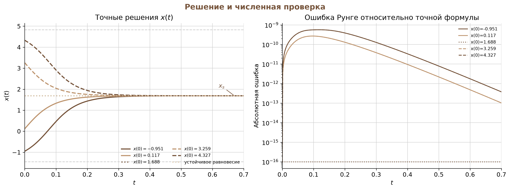

## Решение автономного ОДУ первого порядка

**Задание 3.4.** Решите ОДУ $\frac{dx}{dt}=m\sin(x)+k\cos(x)$ и постройте график $x(t)$ при нескольких вариантах начальных условий.

## Решение

Решим уравнение
$$\frac{dx}{dt}=m\sin x+k\cos x$$
и построить $x(t)$ при нескольких начальных условиях.

**Подставим постоянные и объединяем синус с косинусом**.
$$x'=2\sin x+17\cos x.$$

Найдёс такие $R>0$ и $\varphi$, чтобы
$$2\sin x+17\cos x=R\sin(x+\varphi).$$

Используем формулу суммы комплексных числах:
$$R\sin(x+\varphi)=R\cos\varphi\sin x+R\sin\varphi\cos x.$$

Сравниваем коэффициенты:
$$R\cos\varphi=2,\qquad R\sin\varphi=17.$$

Возводим в квадрат и складываем:
$$R^2(\cos^2\varphi+\sin^2\varphi)=2^2+17^2=293,$$
$$R=\sqrt{293}\approx17.117242769.$$

Оба коэффициента положительны, поэтому $\varphi$ в первой четверти:
$$\varphi=\arctan\frac{17}{2}\approx1.453687582.$$

Получили
$$x'=R\sin(x+\varphi).$$

**Найдём стационарные решения**. До деления на правую часть проверяем, где она равна нулю:
$$\sin(x+\varphi)=0\quad\Longrightarrow\quad x+\varphi=n\pi.$$

Следовательно,
$$x(t)\equiv n\pi-\varphi,\qquad n\in\mathbb Z.$$
Это отдельные постоянные решения, которые можно потерять при разделении переменных.

**Определим устойчивость**. Пусть $f(x)=R\sin(x+\varphi)$. Тогда
$$f'(x)=R\cos(x+\varphi),\qquad f'(n\pi-\varphi)=R(-1)^n.$$

При чётном $n$ производная положительна: решения уходят от равновесия. При нечётном $n$ производная отрицательна: решения приближаются к нему.

Таким образом,
$$x_u=-\varphi+2\pi j$$
— неустойчивые равновесия, а
$$x_s=\pi-\varphi+2\pi j$$
— асимптотически устойчивые равновесия.
В промежутке между $x_u$ и $x_s$ правая часть положительна, а между $x_s$ и следующим $x_u$ — отрицательна. Решения с обеих сторон движутся к $x_s$.

**Решим разделением переменных**. На промежутке между соседними неустойчивыми равновесиями выбираем
$$x_s=\pi-\varphi+2\pi j,\qquad v=x-x_s,\qquad-\pi<v<\pi.$$

Тогда
$$x+\varphi=\pi+2\pi j+v,$$
$$\sin(x+\varphi)=\sin(\pi+v)=-\sin v.$$

Следовательно,
$$v'=-R\sin v.$$

При $v\ne0$ разделяем переменные:
$$\frac{dv}{\sin v}=-R\,dt.$$

Введёс интегрирование через замену $u=\tan(v/2)$:
$$\sin v=\frac{2u}{1+u^2},\qquad dv=\frac{2,du}{1+u^2}.$$

Тогда
$$\frac{dv}{\sin v}=\frac{2,du}{1+u^2}\frac{1+u^2}{2u}=\frac{du}{u},$$
$$\ln|u|=-Rt+C.$$

После возведения в экспоненту знак включаем в вещественную постоянную:
$$u=C_1e^{-Rt}.$$

Начальное условие $x(0)=x_0$ даёт
$$C_1=\tan\frac{x_0-x_s}{2}.$$

Поскольку $v\in(-\pi,\pi)$, имеем $v/2\in(-\pi/2,\pi/2)$: можно использовать главную ветвь арктангенса без скачка на $2\pi$.

**Запишем решение задачи Коши**. Для
$$-\varphi+2\pi j<x_0<2\pi-\varphi+2\pi j$$
получаем
$$x(t)=x_s+2\arctan\left[\tan\frac{x_0-x_s}{2}\,e^{-\sqrt{293}\,t}\right],\quad x_s=\pi-\varphi+2\pi j.$$
Формула также даёт постоянное решение при $x_0=x_s$. На границах промежутка стоят неустойчивые постоянные решения; их записываем отдельно.

При $t\to+\infty$ экспонента стремится к нулю, поэтому
$$\boxed{x(t)\longrightarrow x_s.}$$
Устойчивое равновесие не достигается за конечное время непостоянным решением. Правая часть гладкая, и единственность не позволяет ему пересечь равновесное решение.

**Проверяем формулу подстановкой**. Обозначим $u=C_1e^{-Rt}$. Тогда
$$x'=-\frac{2Ru}{1+u^2}.$$

С другой стороны,
$$R\sin(x+\varphi)=-R\sin(2\arctan u)=-\frac{2Ru}{1+u^2}.$$

Обе части совпадают. При $t=0$ арктангенс восстанавливает $(x_0-x_s)/2$, следовательно, начальное условие также выполнено.

**Выбираем начальные условия и время**.  Для наглядности берём один промежуток:
$$x_L=-\varphi\approx-1.453687582,$$
$$x_s=\pi-\varphi\approx1.687905071,$$
$$x_R=2\pi-\varphi\approx4.829497725.$$

Внутри промежутка выбираем пять начальных точек с долями $0.08,0.25,0.50,0.75,0.92$ от его длины. Это показывает возрастание снизу, убывание сверху и постоянное решение посередине. Отдельно отмечаем оба неустойчивых равновесия.

Характерное время малых отклонений $1/R\approx0.05842$. Отрезок $0\le t\le0.7$ содержит примерно 12 таких времён, поэтому приближение к равновесию хорошо видно. Основная сетка имеет шаг 0.001 с. Численное решение сравниваем с точной формулой.

